<p align="center">
  
</p>

<p align="center">
  
</p>

<p align="center">
  <code>&gt; GoLsik = goal seek</code> &nbsp;·&nbsp; <code>in search of a target</code>
</p>

<p align="center">
  I build small, polished tools for streamers and gamers —<br>
  the kind you download, run, and forget about because they just work.
</p>



### `> projects`

<p align="center">
  <a href="https://github.com/GoLsik-web/songrequest"></a>
  <a href="https://github.com/GoLsik-web/songrequest-yandex"></a>
</p>


### `> stack`

<p>
  <code>Go</code> · <code>JavaScript</code> · <code>Python</code> · <code>PySide6</code> · <code>Electron</code> · <code>React Native</code> · <code>FFmpeg</code> · <code>OBS</code>
</p>

### `> principles`

```text
1  it works on my machine. and now on yours
2  every bug is a feature until someone notices
3  viewers request trash, the app plays it anyway
4  Spotify rate limit is my final boss
```

<p align="center">
  
</p>
