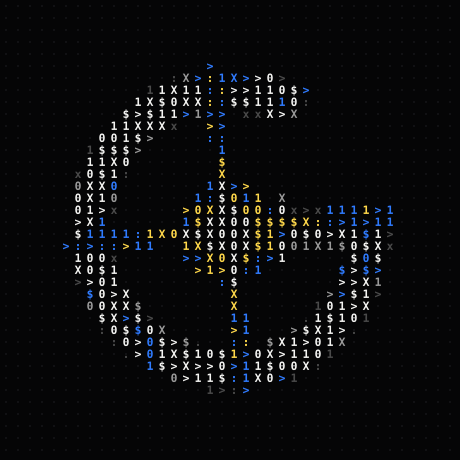

<p align="center">
  
</p>

<p align="center">
  <code>&gt; GoLsik = goal seek</code> &nbsp;·&nbsp; <code>in search of a target</code>
</p>

<p align="center">
  I build small, polished tools for streamers and gamers —<br>
  the kind you download, run, and forget about because they just work.
</p>


### `> projects`

| | |
|---|---|
| **[songrequest](https://github.com/GoLsik-web/songrequest)** | Song requests for Twitch. Viewers redeem channel points or donate, the track plays in your Spotify, and your own music resumes right where it stopped. Comes with a customizable OBS overlay. |
| **[clip-polisher](https://github.com/GoLsik-web/clip-polisher)** | Turns a horizontal stream clip into a vertical 9:16 short: subtitles, layout and branding, rendered on the GPU. |
| **[magicpack](https://github.com/GoLsik-web/magicpack)** | Website for the Magic Pack Minecraft server (1.21.1, NeoForge). |
| **[songrequest-yandex](https://github.com/GoLsik-web/songrequest-yandex)** | The songrequest sibling that plays requests in Yandex Music. |


### `> stack`

<p>
  <code>Go</code> · <code>JavaScript</code> · <code>Python</code> · <code>PySide6</code> · <code>Electron</code> · <code>React Native</code> · <code>FFmpeg</code> · <code>OBS</code>
</p>

### `> principles`

```text
1  one .exe, no install, no account
2  every error has a code and a next step
3  the viewer always gets an answer
4  looks good on stream
```

<p align="center">
  
</p>
